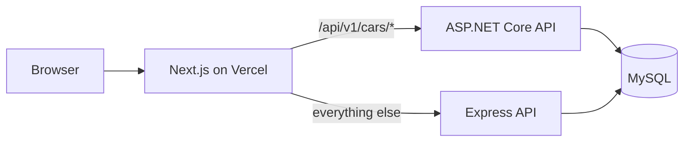

# Nexora Rent API (.NET)

[](https://github.com/iligashi/nexorarent-api/actions/workflows/ci.yml)


ASP.NET Core backend for **[Nexora Rent a Car](https://github.com/iligashi/nexorarent)**, built to
replace the existing Express API **one route group at a time, without downtime**. Both backends
share the same MySQL database and the same JWT secret, and the Next.js frontend does not change:
Next.js rewrites decide which backend serves each route.

> **Status:** early. The public cars endpoints and `GET /auth/me` are ported and tested.
> See the [migration plan](docs/migration-plan.md) for what comes next.

## What's here

| Endpoint | Description |
|---|---|
| `GET /api/v1/cars` | Paged list with category, fuel, transmission, price and text filters, and sorting |
| `GET /api/v1/cars/featured` | Up to 6 featured cars |
| `GET /api/v1/cars/{slug}` | Car details with image gallery and latest approved reviews |
| `GET /api/v1/cars/{id}/availability` | Whether a car is free for a period, plus its booked periods |
| `GET /api/v1/auth/me` | Current user, from an access token issued by the Express API |
| `GET /api/health` | Database health, same shape as the Express health check |

Every endpoint keeps the Express API's URL, status codes, error messages and snake_case JSON,
so the frontend can switch per route. [Known differences](docs/migration-plan.md#known-differences-from-express)
are listed and intentional.

## Architecture



```
src/
  NexoraRent.Api/             Minimal API endpoints, JWT auth, CORS, rate limiting, error handling
  NexoraRent.Core/            Domain types and rules (booking periods, list queries), repository interfaces
  NexoraRent.Infrastructure/  Dapper + MySqlConnector repositories
tests/
  NexoraRent.UnitTests/         Domain rules
  NexoraRent.IntegrationTests/  Full HTTP tests against MySQL 8.4 in Docker (Testcontainers)
```

Design decisions are recorded in [`docs/adr`](docs/adr), starting with
[why Dapper instead of EF Core](docs/adr/0001-dapper-over-ef-core.md).

## Highlights

- **Token compatibility:** validates the HS256 access tokens Express issues (`userId` claim,
  no clock skew) and returns the same 401 messages (`Token expired`, `Invalid token`, ...).
- **Shared configuration:** reads the Express variable names (`DB_HOST`, `JWT_SECRET`,
  `CLIENT_URL`, ...), so one Railway config serves both services.
- **Contract tests:** integration tests start a real MySQL container, load the schema and seed
  data, and assert on the exact JSON the frontend reads.
- **Production basics:** request ids in `X-Request-Id`, JSON logs, per-IP rate limiting,
  credentialed CORS allow-list, non-root Docker image, warnings treated as errors.

## Run locally

Requirements: [.NET 10 SDK](https://dotnet.microsoft.com/download) and the MySQL database from the
nexorarent repo (`docker compose up -d` there, which listens on `127.0.0.1:3307`).

```bash
cp .env.example .env   # same DB and JWT values as the Express API
dotnet run --project src/NexoraRent.Api
```

The API listens on `http://localhost:5080`. In development, the OpenAPI document is at
`/openapi/v1.json`.

With Docker instead:

```bash
docker compose up --build
```

## Tests

```bash
dotnet test --solution NexoraRent.slnx
```

Integration tests need Docker. Without it they are skipped locally; CI sets `REQUIRE_DOCKER=true`
so they always run there.

## Connect the frontend

In the nexorarent repo, add rewrites to `client/next.config.ts` and set
`NEXT_PUBLIC_API_URL=/api/v1`. The full snippet is in the [migration plan](docs/migration-plan.md#how-traffic-is-split).
